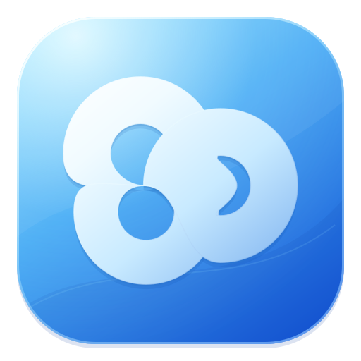
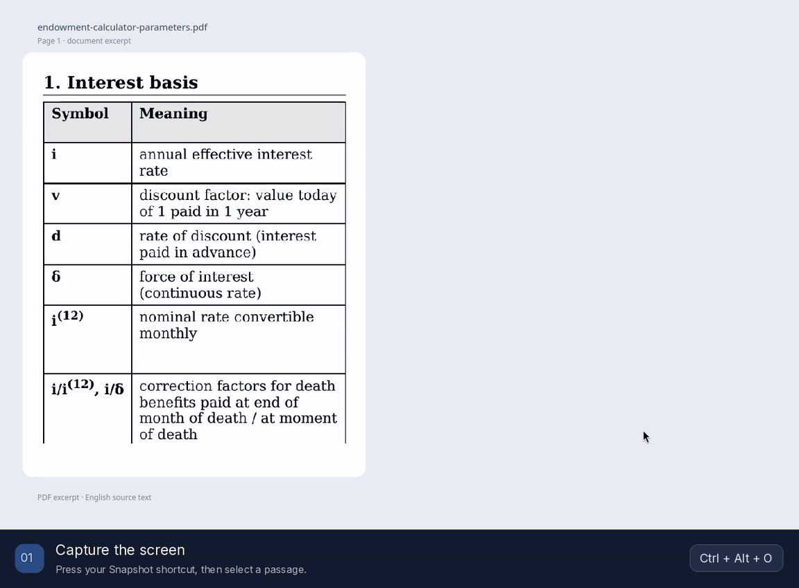

<p align="center"></p>

# Ranslator

Translate selected text or words on your screen, then keep reading where you were.
A native Linux app with a Rust core, OCR and a floating translation popup.



*Actual Snapshot recording: English → Spanish with local Ollama. Hold Shift for multiple selections, then drag the cards. [Recording notes](assets/screenshots/README.md).*

- **Select or capture.** Translate text selections, images and otherwise unselectable screen content.
- **Keep several translations open.** Select multiple regions, move and resize their cards, or expand one for comfortable reading.
- **Choose your engine.** Ollama, OpenAI-compatible APIs, CLI runtimes, LibreTranslate or MyMemory.
- **Make it yours.** Preferred and fallback languages, editable source language, shortcuts, light/dark themes, OCR packs and a start-at-login toggle.

## Get it

[Releases](https://github.com/ayovu/ranslator-screen-translator/releases) · [Build from source](docs/USER_GUIDE.md#build-and-verify) · [User guide](docs/USER_GUIDE.md)

The first public release is being prepared. Linux packages are produced as **AppImage** and **Flatpak**, with Qt, Tesseract and English OCR included. Additional OCR packs include Ukrainian, Japanese, Chinese and Arabic. No LLM weights are downloaded automatically.

Automatic translation uses an available local Ollama model, otherwise the online MyMemory service. Choose Ollama explicitly for local-only translation.

Developed on **Arch Linux / KDE Plasma Wayland**. Other Wayland desktops and X11 use their available integrations; shortcuts, monitor capture and blur can differ. **macOS is experimental:** it builds, packages and runs on Apple Silicon with macOS 27, and its desktop checks are still in progress. See the [platform validation notes](docs/PORTABILITY.md).

AUR and Flathub publication is planned; the app is not listed there yet. [Packaging and release details](docs/RELEASING.md).

## Build

Pick the row for the machine you build on. There are no cross builds: a Mac package is built on a Mac of the same architecture.

| Target | Build on | Command | Result | Runs on |
| --- | --- | --- | --- | --- |
| Linux x86_64 | Linux with the [build dependencies](docs/USER_GUIDE.md#build-and-verify) | `scripts/install.sh` (or `scripts/package-appimage.sh`, `scripts/package-flatpak.sh`) | `~/.local` install, AppImage or Flatpak | glibc desktops; Wayland or X11 |
| macOS Apple Silicon | An Apple Silicon Mac with Xcode | `scripts/package-macos.sh` | `dist/macos-arm64/Ranslator.app` and ZIP | macOS 14.4 or newer\* |
| macOS Intel | An Intel Mac with Xcode | `scripts/package-macos.sh` | `dist/macos-x86_64/Ranslator.app` and ZIP | macOS 14.4 or newer\* |

\* Qt 6.12's minimum. The script raises it to the newest minimum among the bundled libraries, which is the build machine's macOS when Homebrew compiles them from source. The same source gives each platform its own look: Ranslator's glass on Linux; on macOS the system font, accent color, SF Symbols and Liquid Glass (macOS 26 and later; vibrancy on 14 and 15). Details: [Mac build guide](packaging/macos/README.md).

For development on either platform, install the [platform dependencies](docs/USER_GUIDE.md#build-and-verify), then:

```sh
cargo build --release --locked
cargo run --release --locked -- --window
```

On Linux, `scripts/install.sh` installs to `~/.local`.

## Contribute

Bug reports, focused pull requests and platform testing are welcome. Read [CONTRIBUTING.md](CONTRIBUTING.md); platform ports and coding agents should also follow the [shared architecture guide](docs/AGENT_GUIDE.md).

Want to translate the interface? Start with the [translation guide](docs/TRANSLATING.md). English is the source language; community catalogs are separate from OCR packs.

[GNU GPL v3](LICENSE). Bundled components retain their own licenses.
