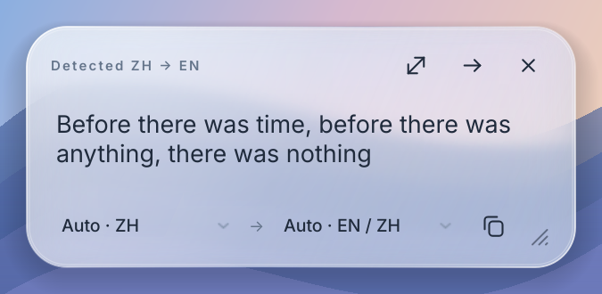

# Ranslator user and build guide

A native Linux translator with a Rust core and Qt 6 widgets, developed on KDE Plasma/Wayland. macOS adapters and local packaging are experimental and still require real-Mac validation. Select text in another application, or capture the screen and select OCR words. No browser engine, background model download, or root input access.



Native Qt render with sample text over a test backdrop. On KDE, the live window uses compositor background blur.

## Install

Build artifacts are separated by platform. Use the installed `~/.local/bin/ranslator` on the original Arch/KDE machine. Portable packages are built locally; this repository does not publish binaries automatically.

- **Portable Linux AppImage:** `scripts/package-portable.sh` creates `dist/portable/Ranslator-<architecture>.AppImage` using a glibc 2.35 baseline. Run `chmod +x` on the file before launching. Without FUSE, set `APPIMAGE_EXTRACT_AND_RUN=1`. See [portable build instructions](../packaging/portable/README.md) and the actual validation report before sharing.
- **Flatpak:** package the portable AppDir using the instructions above, then `flatpak install --user dist/portable/Ranslator.flatpak`. Launch with `flatpak run io.github.ranslator.Ranslator`; the required Freedesktop runtime is installed separately. The package declares host-command and accessibility permissions for desktop integration.
- **Native Arch:** install dependencies below, then `scripts/install.sh`. This installs to `~/.local` and adds a menu entry. `scripts/uninstall.sh` preserves settings. A native Arch AppImage from `scripts/package-appimage.sh` uses the builder's newer libraries; it is separate from the portable build.
- **macOS:** build on the target Mac with `scripts/package-macos.sh`; see [Mac instructions](../packaging/macos/README.md). No verified Mac binary is produced on Linux. Apple Silicon and Intel outputs remain separate.

For source archives, contribution guidelines, and release preparation, see [CONTRIBUTING.md](../CONTRIBUTING.md) and [docs/RELEASING.md](RELEASING.md). No GitHub Actions are required or configured.

Developers and coding agents adapting the app to another platform should follow
the [shared architecture and platform contribution guide](AGENT_GUIDE.md).

Both bundles contain Tesseract, the English OCR model, Qt and required native libraries. They do not bundle an LLM: automatic mode discovers a running local Ollama instance and its first installed model. If none is available at startup, it uses the free online MyMemory service. The widget displays the provider. MyMemory has service quotas, a 500-byte request limit, and limited language-pair availability. Choose Ollama explicitly to ensure text stays local.

## Use

| Action | Default shortcut | Behaviour |
| --- | --- | --- |
| Translate selection | `Alt+Shift+C` (Option+Shift+C on a Mac) | Select text in another app first, then press it to translate that selection. |
| Select once | `Ctrl+Alt+R` | Arm, then select text in another app. Translate the next settled selection. |
| Auto translate | `Ctrl+Alt+Y` | Toggle continuous selection translation. |
| Snapshot | `Ctrl+Alt+O` | Capture the current monitor where supported, then click or drag across recognized words. |

The three selection actions are trigger rules you can mix: **Translate selection** acts only when you press it, **Select once** waits for your next selection, and **Auto translate** translates every selection until turned off. Translate selection leaves a running listener alone and can be turned off in **Settings → Shortcuts**. Settings saved before it existed gain its default chord unless another action already uses it; it then starts unset. It reads the selection through Accessibility on macOS, data-control on Wayland and PRIMARY on X11. Mac apps that keep their selection out of Accessibility, such as browsers and Electron apps, are read with ⌘C, after which every clipboard item is restored; password fields are never read. Desktops without a way to read the current selection, such as GNOME without data-control, explain that Select once or Snapshot still work.

The app starts in the tray by default. A translation opens a compact tool window over your current application, without a taskbar entry. Click outside, press Escape or close it to dismiss. **Expand** opens the full translator explicitly; `ranslator --window` does the same. Open settings from the tray or with `ranslator --settings`. Disable **Settings → Languages → Show translations as a compact popup** for the full-window workflow. Use **Quit** in the tray menu to exit. `Ctrl+Enter` (⌘↩ on a Mac) translates edited or pasted text. **Auto translate** translates each new text selection in other apps; its caption changes to **Auto: on** while enabled. Click it again to stop. **Stop** cancels listening and discards pending results. **Copy** copies the translation. Drag the top header to move the frameless window, or its edges to resize it. The language-swap button reverses the last translated language pair.

Snapshot freezes the current screen before OCR finishes. The scene is dimmed, with a spotlight following the cursor. Start selecting immediately: a selection made before full-screen OCR completes is recognized as a smaller crop, on an independent worker so an earlier translation cannot block recognition. No intermediate full translator window opens. After selection the frozen overlay leaves and the compact result appears over your original application. Enable **Settings → Screen text → Copy selected snapshot text to clipboard** to copy the source automatically.

Snapshot selection uses the actual screenshot pixels, scaled without changing the aspect ratio. Drag across words to translate, click a single word, or press `Ctrl+A` then `Enter` for everything. **Select all**, **Translate selection** and **Translate all** are visible in the toolbar; **Zoom** reveals zoom and Fit controls. Scroll to zoom or right-drag to pan. `Esc` cancels the snapshot when no expanded reader is open. Settings → Screen text offers current monitor, all monitors, area selection, and the system picker. KDE builds use an installed Spectacle for direct capture, including through the host-command bridge in Flatpak. Current monitor follows KWin's active output and the screenshot's output metadata; the fullscreen surface is explicitly bound to that monitor. All monitors produces a combined overview on the monitor where Snapshot was invoked. X11 supports direct capture. Other Wayland desktops use the screenshot portal or an explicitly enabled compositor integration; portal capabilities determine whether an exact monitor can be selected. See the platform notes below. Images can also be opened from the tray menu.

Drag the bottom-right grip of a translation widget or snapshot card to resize it. Its full-screen reading button expands that translation; snapshot cards remain in the same overlay, preserving the other cards and their source links. Tap **Shift** by itself, press **Esc**, or use the return button to restore the previous size and position. Shift+arrow and Shift+mouse selection remain available for copying text, and long translations scroll. The quick widget also retains a separate **Open full translator** button.

**Multiple translations:** hold `Shift` or `Ctrl` while selecting the first region. The frozen screen then stays open until `Esc` or **Cancel**, and further selections add cards without needing to hold the modifier. Each card has a matching numbered, colored source underline and connector. Drag its header to move it; click anywhere on a card to bring it forward. Language changes, Copy, Retry and Close affect only that card. You can select several areas before OCR finishes. Requests keep their own results and run at most two at a time (up to 32 unfinished requests). Closing a card removes its queued work and ignores late results; leaving the snapshot cancels the whole session. Running CLI processes are stopped; an HTTP call already sent may finish or reach its configured timeout before its worker slot is released. Ordinary selection still opens the existing compact popup.

In Settings, choose your preferred and fallback languages. Text detected in the preferred language uses the fallback. Both the compact popup and each snapshot card offer source and target selectors, including typed ISO codes or language names. **Auto · RO**, for example, identifies a detected source, not a confirmed language. Very short or mixed-language selections can be misdetected; choose the source manually to translate the original text again. Each snapshot card keeps its own language choices, and older responses cannot replace a corrected translation. Available output languages depend on your provider/model.

Shortcuts support one, two, or three presses within a configurable interval. Recent KWin and native X11 support modifier-only sequences such as `Shift` twice or `Ctrl+Shift` three times; the macOS adapter requires Input Monitoring permission for these gestures. Keep each modifier press under 400 ms. GNOME Wayland requires ordinary chords such as `Ctrl+Alt+R`; its Shell integration cannot observe arbitrary modifier taps while another native Wayland app has focus. For desktops without shortcut registration, bind the commands `ranslator --translate-selection`, `ranslator --select`, `ranslator --listen`, and `ranslator --snapshot` in the desktop settings. The app reports shortcut conflicts instead of replacing another app's binding.

In **Settings → Shortcuts**, click a shortcut's **Record** field, then press and
release the desired keys. The highlighted field says **Listening** while recording.
`Esc`, clicking elsewhere or leaving the window cancels an unfinished recording.
Set **1–3 presses** separately, then **Save**. Recording suppresses Ranslator's own
shortcut actions. Desktop-reserved keys may be intercepted; a portal-assigned
shortcut whose actual keys are unknown is reported instead of guessed.

### Start at login

Use **Start at login** in the tray menu or **Settings → Startup**. This switch
applies immediately; the Settings **Save** button is not required. Errors leave
the displayed state tied to the system's response. Closing and reopening Settings
does not lose a pending change.

- **Native Linux / AppImage:** registers an XDG autostart entry with `--background`.
  Keep the AppImage in its permanent location; moving or deleting it breaks the
  saved launcher. Relaunch from the new location and enable startup again. The
  app reads existing registration when the menu/settings opens or focus returns.
  Minimal compositor sessions must run XDG autostart entries themselves.
- **Flatpak:** requests startup through the Background portal; the desktop may
  ask permission. The public portal has no read-only status query, so the switch
  explicitly displays its last confirmed response. Changes made in other tools
  cannot be verified here. A missing/unsupported portal produces an error.
- **macOS:** the packaged `.app` registers through Login Items. If approval is
  required, use **Open Login Items settings**; uncheck the switch to cancel the
  registration. A loose development executable cannot register this way. Actual
  registration and login behavior still require testing on a Mac, including
  whether a full window appears when compact popup mode is disabled.

Native Linux paths containing `=` or line breaks are rejected with instructions
to move the app. Generated entries contain the launcher and fixed startup arguments;
they do not copy environment variables or credentials.

## Translation providers

| Provider | Configuration |
| --- | --- |
| Automatic | Checks `127.0.0.1:11434` when the desktop app starts or settings change; uses your chosen installed Ollama model, otherwise the first available. The resolved provider stays fixed for that session. |
| Ollama | Base URL defaults to `http://127.0.0.1:11434`; **Refresh** lists models from the configured runtime. Choose a model or type its name. Localhost keeps requests on your device. |
| Compatible LLM API | Base URL ending in the API prefix, e.g. `https://your-server/v1`; model and API key. Uses `/chat/completions`. Also supports compatible local servers on localhost. |
| LibreTranslate | Base URL, optional key; uses `/translate`. |
| MyMemory | No account required; selected text is sent to `api.mymemory.translated.net`. |
| Local command | Executable and JSON argument array. Input text arrives on stdin; UTF-8 stdout is the translation. No shell interpolation. |

For a CLI adapter, arguments can contain `{source}` and `{target}`. The same values are supplied as `RANSLATOR_SOURCE` and `RANSLATOR_TARGET`. Wrap runtimes that require a prompt in a small script; logs belong on stderr. The app itself never inserts selected text into command arguments or a shell command.

Built-in LLM providers and CLI presets share instructions to translate every sentence faithfully, preserve uncertainty, negation and numbers, and copy code expressions verbatim. Reported refusals, output limits and provider failures produce actionable errors; authentication, quota and timeout errors are distinguished. These checks use response metadata and cannot establish semantic accuracy or reliably detect a refusal written as ordinary prose. Compare an unexpected result with the source and retry or change models.

Settings → Translation discovers models when opened. Under **Local command / runtime**, **Detect runtimes** searches PATH and common user installation directories for Codex, Claude Code, OpenCode and Antigravity CLI (`agy`). Choosing a preset fills editable executable and argument fields, wraps stdin in a translation prompt, and extracts response text. **Custom command** keeps raw stdin/stdout behavior. The model and timeout remain editable.

Each provider and CLI runtime remembers its own URL, model, credentials, command arguments and timeout. Switching restores that draft and refreshes its model list; **Save** persists all drafts while the selected provider supplies the active translation settings. Late discovery responses cannot replace another provider's models. Ollama selects the first available model if the saved model is missing; compatible APIs also allow manually entered IDs absent from their catalog. Manual executable and argument changes survive switching runtimes.

OpenCode lists models from the installed runtime, with a default filter for identifiers explicitly labeled `-free` or `:free`; availability and quotas belong to the upstream provider. This is a CLI integration, not a claim that coding models run locally. Existing CLI authentication is used; expired logins must be renewed in the runtime. Detection does not log in or send text. Presets run in temporary empty directories with restricted tool settings where supported; never enable bypass-permissions flags for translation.

 **Refresh** also works with compatible APIs that implement `/models`; servers without that endpoint still accept a typed model name. Model discovery sends no selected text. Install large LLM weights through your runtime; Ranslator does not download them implicitly.

Flatpak can reach host Ollama over localhost and run detected or manually configured host CLI runtimes through `flatpak-spawn --host`. This requires the declared `org.freedesktop.Flatpak` permission; denied access produces an explicit error. Host execution uses the existing host login and a shared private temporary directory. It does not require copying credentials into the sandbox. Custom OCR model files should be selected from a directory accessible inside the sandbox; the app's private data directory works without adding filesystem permissions.

## OCR and desktop support

English OCR runs locally with bundled `tessdata_fast`. Open **Settings → Screen text → Language packs** to download any of 24 curated languages, including Ukrainian, Chinese, Japanese and Arabic. The dialog shows download sizes and verifies SHA-256 checksums against a pinned upstream revision before installing. **Select all** and **Download all packs** install the whole catalog in one operation. Installation is separate from activation: choose up to eight active OCR languages; fewer usually improves speed and accuracy. Downloading the whole catalog preserves your active language set. Packs are stored in `$XDG_DATA_HOME/ranslator/tessdata` (normally `~/.local/share/ranslator/tessdata`), including inside Flatpak's private storage. Downloads happen only after a download button is pressed; Save applies the active OCR selection. Save keeps settings open, and Close leaves the last saved values in place.

On macOS, Snapshot reads text with Apple Vision by default. It runs on the device, needs no model downloads, detects languages on its own and uses the OCR languages as preferences; it also reads small, light-on-dark and mixed-script screen text that the bundled English Tesseract model misses. Vision compiles its recognizer the first time each app uses it after installation or a macOS update, which takes about a minute, so Ranslator prepares it in the background at startup. **Settings → Screen text → Recognition** switches to the bundled Tesseract engine and its language packs (`"ocr_engine": "tesseract"`); `"auto"`, the default, means Vision on macOS and Tesseract elsewhere. If Vision fails, the error says so instead of silently changing engines.

For languages outside the catalog, put compatible `.traineddata` files in a custom directory and set language codes such as `eng+ukr`. Custom, managed, bundled and system models can be combined. Text translation itself supports more languages than the OCR catalog. Maintain the catalog with `python3 scripts/update-ocr-catalog.py` after reviewing the pinned revision and language list in that script; it downloads the listed models to calculate checksums without bundling their weights.

| Platform | Implementation and validation boundary |
| --- | --- |
| Arch/KDE Wayland | Primary selection, KDE shortcuts, modifier-only gestures with keystate v5, direct Spectacle/portal capture, and monitor-aware overlays. Real desktop checks have run on the development machine. |
| Native X11 | Primary selection, passive global key grabs, modifier-only gestures, and direct capture/region selection. Isolated Xvfb interaction tests pass; a physical multi-monitor X11 desktop remains a separate validation step. |
| GNOME Wayland | Screenshot portal and AT-SPI selection fallback. An experimental, explicitly enabled Shell companion adds compositor integration; its supported versions and limits are documented under `integrations/gnome/`. Arbitrary modifier-only gestures are not supported. |
| Other Wayland compositors | Selection through ext/wlr data-control or AT-SPI; screenshots and global shortcuts depend on the installed portals. Desktop command bindings are available where shortcut registration is missing. Exact monitor targeting and blur depend on compositor support. |
| macOS / Apple Silicon and Intel | Source adapters for AX selection, ScreenCaptureKit capture at the display's pixel resolution, Apple Vision OCR, shortcuts and AppKit blur, plus a native `.app` build script. Builds, passes the local checks and packages on Apple Silicon with macOS 27; the desktop checks in the [Mac handoff](PORTABILITY.md#mac-handoff) are still pending, so it remains experimental, not a verified release. |

Wayland does not expose arbitrary applications' internal text or global mouse-release events. Data-control selection uses a configurable quiet period (500 ms by default); pauses while dragging can trigger early. AT-SPI works only when the source application exposes selected text. Images, protected fields and inaccessible canvases require OCR. KWin's modifier protocol reports modifiers only, so short Shift presses while typing can resemble a gesture; ordinary chords avoid that ambiguity.

See [validation and platform limits](PORTABILITY.md). A successful container render is evidence of compatible bundled libraries, not proof that every compositor integration works.

## Appearance

The interface uses translucent, rounded glass surfaces, a floating language selector, a large translation card, pill controls and a sidebar for settings. KDE WindowSystem supplies native blur and background contrast; reflective borders, gradients and soft shadows are painted locally with Qt. Inter and Noto fallback fonts are embedded for consistent typography and for the scripts in the language picker, including CJK, Arabic, Hebrew, Devanagari, Bengali and Thai. Other scripts depend on available system fonts. CJK translation text selects regional font variants from the target language. Hover and translation transitions respect **Settings → Appearance → Reduce motion**. Choose system, light or dark appearance, or **Reduce transparency** for a solid material. Without compositor blur support, the material becomes opaque for readability.

This is a KDE glass implementation, without optical refraction. The referenced [`liquid-glass-rs`](https://github.com/Stapxs/liquid-glass-rs) uses macOS 26+ AppKit and cannot render on Linux. The shared design lives in `native/design.cpp`; platform blur adapters supply the backdrop without changing the widget layout.

On macOS the same layout follows the platform instead: San Francisco with PingFang, Hiragino or Apple SD Gothic Neo for CJK text, the user's accent color, SF Symbols, capsule controls, a segmented mode bar whose thumb slides on a spring, and windows that fade in. The window body is real Liquid Glass (`NSGlassEffectView`) on macOS 26 and later and vibrant `NSVisualEffectView` material before that, with a light legibility tint, hairline edges and a painted shadow that follows the rounded body (AppKit sizes its own shadow to the whole transparent window). Shortcuts read ⌥⇧C rather than Alt+Shift+C, and ⌘↩ translates. The system Reduce motion and Reduce transparency settings apply too. `ranslator --design-preview DIR` also writes `glyphs.png`, every icon at 16–48 px in both themes, drawn and native side by side.

## Build and verify

Arch dependencies:

```sh
sudo pacman -S --needed rust gcc cmake ninja pkgconf qt6-base qt6-wayland qt6-svg kglobalaccel kwindowsystem tesseract xcb-util-keysyms libxcb libxkbcommon
cargo run
cargo test --all-targets
cargo test --test core repeated_shortcuts
cargo fmt --check
cargo clippy --all-targets -- -D warnings
cargo build --release --locked
```

Qt 6.4+ is required. KDE Frameworks GlobalAccel and WindowSystem are optional for development builds; portable release builds require them and the X11 libraries so the bundle retains those integrations. On other desktops, the appropriate adapter/portal is used; without a blur provider the material becomes opaque. CMake resolves platform libraries for Cargo. `clang-format -i native/*.cpp native/*.hpp` formats the UI bridge.

Portal integration tests use a fake screenshot service on a private D-Bus session, covering accepted, cancelled, failed, concurrent and stale requests without capturing your desktop:

```sh
cmake -S native -B build/ui-tests -DRANSLATOR_UI_TESTS=ON
cmake --build build/ui-tests --target ui_tests -j 2
ctest --test-dir build/ui-tests --output-on-failure

cmake -S native -B build/portal-tests -DRANSLATOR_PORTAL_TESTS=ON
cmake --build build/portal-tests --target portal_tests -j 2
ctest --test-dir build/portal-tests --output-on-failure
```

```sh
./target/release/ranslator --doctor
printf 'Hello, this is a test sentence.' | ./target/release/ranslator --translate es
./target/release/ranslator --ocr picture.png
./target/release/ranslator --image picture.png
QT_QPA_PLATFORM=offscreen ./target/release/ranslator --smoke-test /tmp/widget.png
QT_QPA_PLATFORM=offscreen ./target/release/ranslator --design-preview build/design-preview
scripts/package-appimage.sh
scripts/package-flatpak.sh
python3 scripts/verify-bundles.py
# Optional on a running KDE Wayland desktop; opens each package briefly:
python3 scripts/verify-bundles.py --kde-blur
```

Packaging downloads official linuxdeploy tooling on its first run. The Flatpak wrapper uses the already-built AppDir and requires the matching Freedesktop runtime, without installing a compiler SDK. A corresponding flatpak-builder manifest is in `packaging/flatpak/`. Host CLI tests run with synthetic executables and cover discovery, output limits, exit errors, cancellation, denied permission and descendant cleanup. Changing that runtime requires checking the bundled libraries' glibc requirements. Nothing is published to Flathub or AppImageHub by these scripts.

For an optional live integration check, launch the app and run `/usr/bin/python3 scripts/check-desktop.py` with Python GObject/AT-SPI and `wl-clipboard` installed. It uses a synthetic PRIMARY selection, verifies that it reaches the compact popup and produces a translation, and restores the previous text selection. It can call the configured provider. Unit tests use fixtures and a local mock HTTP server.

`/usr/bin/python3 scripts/check-snapshot.py` additionally compiles a temporary fullscreen fixture and verifies KDE shortcut → screenshot → OCR → zoom/fit → selected-text translation. Use Automatic snapshot mode and Spectacle. It refuses to translate a capture that does not match the fixture. It temporarily covers the current monitor and calls the configured provider. Both live checks require an idle desktop session.

With the regular app stopped, `/usr/bin/python3 scripts/check-monitors.py` covers each physical monitor with a synthetic fixture, then verifies current-monitor and combined-desktop captures and fullscreen placement on each output. It uses a temporary profile and makes no translation requests. Requires KDE Wayland, Spectacle, XWayland, xdotool and Python GObject/AT-SPI. The native UI suite also covers provider switching, stale model replies, saved profiles, and model selection; Rust tests cover bounded model discovery and profile serialization.

`/usr/bin/python3 scripts/check-multi-snapshot.py` uses a private D-Bus session, Xvfb display, temporary configuration, synthetic image and local mock API. It exercises real mouse gestures, three selections before OCR, Tesseract, out-of-order translation replies, dragging and Escape through the release binary. It never captures the user's desktop or calls a cloud provider. Requires Xvfb, xdotool, fontconfig, Python Pillow/GObject and AT-SPI; saves the rendered test scene as `build/multi-snapshot.png`.

## Configuration and maintenance

Settings live in `$XDG_CONFIG_HOME/ranslator/config.json` (normally `~/.config/ranslator/config.json`), or Flatpak's private config directory. `RANSLATOR_CONFIG` overrides the path. Settings are atomically replaced with mode 0600. `RANSLATOR_API_KEY` overrides the saved key by default; the variable name is configurable. No selection history or translation cache is written to disk. Screenshots use a private temporary directory and are removed after loading the selection view or on normal exit.

`provider_profiles` stores saved engine drafts under provider IDs (`ollama`, `compatible`, etc.) or `cli/<runtime>`. The top-level fields remain authoritative for translation and preserve compatibility with existing configurations. Old settings acquire profiles on their next save. Remembered credentials remain in the same private configuration file; use environment variables if you prefer not to save them.

[`config.example.json`](../config.example.json) contains the default settings without credentials. Prefer Settings for normal setup; for a separate profile, copy the example outside the repository and launch with `RANSLATOR_CONFIG=/path/to/profile.json`. No fields are required for automatic mode. Other providers require the fields listed in the provider table above; keep real keys out of the example and Git.

Rust modules in `src/` own configuration, routing, provider requests, subprocess limits, OCR parsing and state machines. `src/platform/linux.rs` owns Wayland selection and KWin modifier protocols. `native/` contains Qt widgets, the screenshot/global-shortcut portal bridge, and KDE registration. UTF-8 JSON messages cross a narrow C ABI; Rust runs blocking work away from the GUI thread. OCR and translation have separate single-worker queues, each cancelling stale work. Selected-area OCR takes priority over pending full-screen recognition. CLI cancellation terminates its process group. HTTP cancellation suppresses stale results immediately; an in-flight request may take until its timeout to finish.

Add providers in `src/provider.rs`, platform adapters under `src/platform/`, and behavioural tests in `tests/`. Keep desktop capability checks separate from translation logic. `AGENTS.md` is preserved as originally supplied.

## Upstream references and licenses

- [KDE window effects](https://api.kde.org/kwindoweffects.html)
- [Inter font](https://github.com/rsms/inter)
- [KDE KGlobalAccel](https://api.kde.org/kglobalaccel.html)
- [XDG screenshot portal](https://flatpak.github.io/xdg-desktop-portal/docs/doc-org.freedesktop.portal.Screenshot.html)
- [Codex non-interactive mode](https://developers.openai.com/codex/noninteractive)
- [Claude Code headless mode](https://code.claude.com/docs/en/headless)
- [OpenCode CLI](https://opencode.ai/docs/cli/)
- [Antigravity headless mode](https://www.antigravity.google/docs/cli/headless/)
- [Ollama chat API](https://docs.ollama.com/api/chat)
- [MyMemory API](https://mymemory.translated.net/doc/spec.php)
- [Tesseract fast models](https://github.com/tesseract-ocr/tessdata_fast)
- [macOS liquid-glass-rs](https://github.com/Stapxs/liquid-glass-rs)

Application code: GPL-3.0-only. Embedded Inter: SIL Open Font License 1.1 (`assets/fonts/OFL.txt`). Bundled English OCR data: Apache-2.0 (license included). KDE's vendored key-state protocol retains its LGPL-2.1-or-later notice. Qt/KDE and other dynamically bundled libraries retain their upstream licenses. Release preparation and store publication requirements are documented in [RELEASING.md](RELEASING.md).
